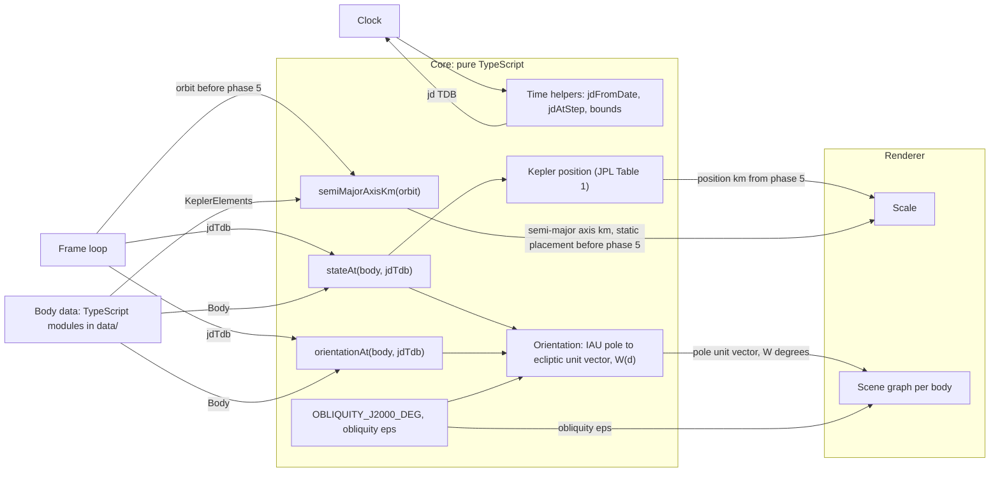
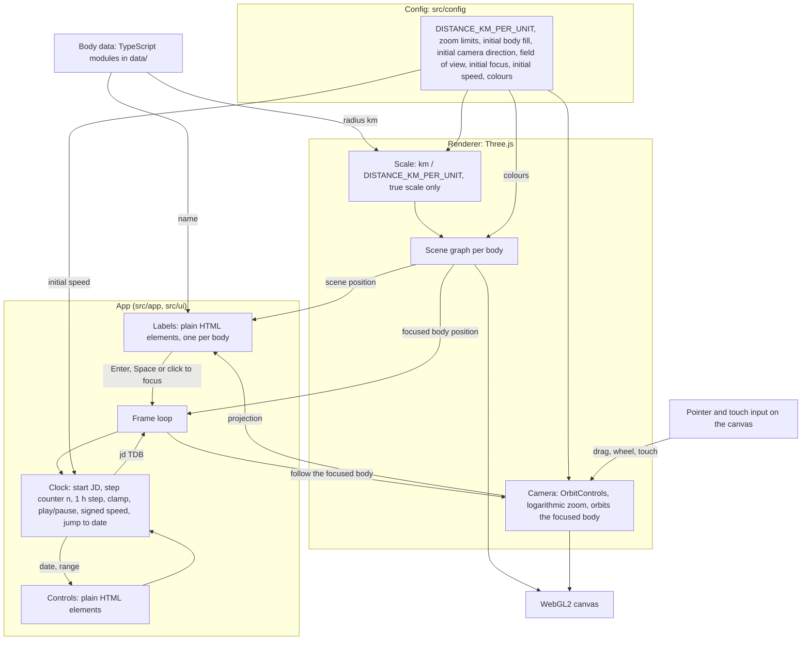
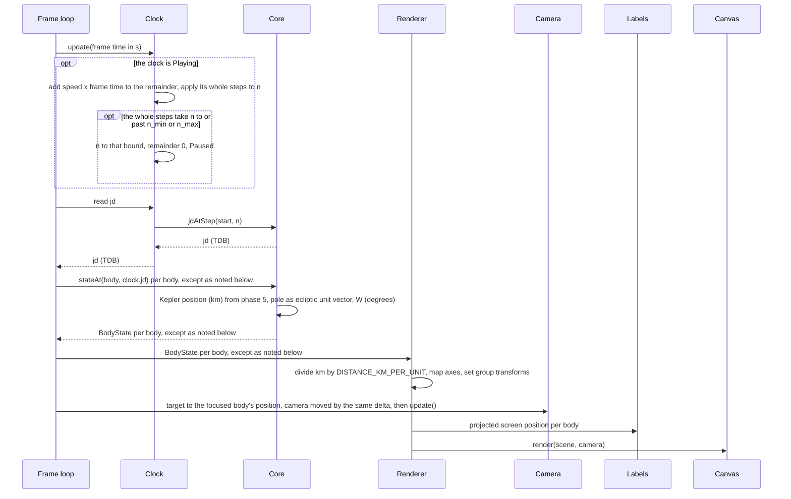
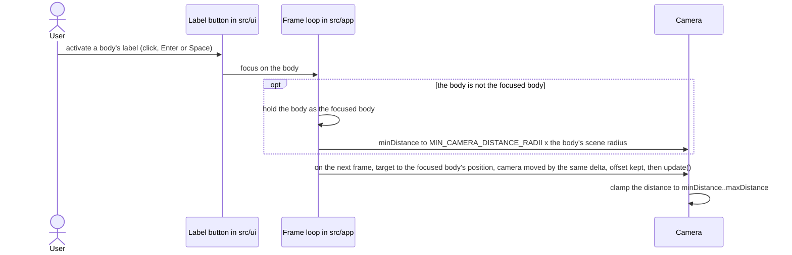
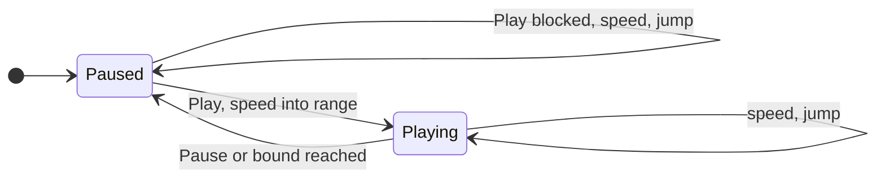

# Architecture

## Goals and constraints

Goals ([README](../README.md) states the purpose):

- Place and orient each body from real data: JPL Keplerian elements for position, IAU pole and prime meridian for orientation.
- Build phase by phase, each phase green ([phases.md](phases.md)).

Constraints:

- Positions come from JPL "Keplerian Elements for Approximate Positions of the Major Planets", Table 1 (1800-2050), not from an N-body integration. Table 1 is chosen over NSSDC mean elements because it states validity range, accuracy and algorithm.
- Core is pure TypeScript. Renderer is Three.js with `MeshBasicMaterial` (unlit).
- The 3D layer is plain TypeScript and Three.js, with no UI framework. UI controls are plain HTML elements. Camera controls are Three.js `OrbitControls` ([View](#view)).
- Orientation uses the IAU pole (RA/Dec) and prime meridian W(d). The Sun rotates as a rigid body (25.38 d).
- Mercury's five small sine terms in W (each < 0.011 deg) are omitted in v1. [data.md](data.md#mercury-orientation) lists them.
- WebGL2 is required. The project is tested by hand in Safari and Chrome on macOS and on the device the child uses; that device is named here when it is tested. No other browser is claimed.
- Frame rate target: at least 60 frames per second on the author's Mac and at least 30 on the device the child uses (default). The check on the child's device applies once that device is named. It is measured with the browser's developer tools at the start view and at the overview zoom ([View](#view)).
- Tooling needs a Node version inside the combined Node range under [Tooling](data.md#tooling).
- Docs are in English.

## Invariants

1. Core never imports Three.js or DOM.
2. Core takes element data as published (AU, degrees) and converts inside. Its outputs are positions and lengths in km, directions as unit vectors, angles in degrees and Julian dates. Only the renderer scales.
3. Sim time is a pure function of the start Julian date and the step counter.
4. Every phase leaves format check, typecheck, tests and build green.

## Architecture

The core, which works in doubles with units in and out as in [invariant 2](#invariants), and the body data, App and renderer nodes it exchanges values with:



Data flows from core to renderer only. Core has no import from renderer, Three.js or DOM. Edges from Core to Renderer show the data flow; the App hands the values over (see [One tick](#one-tick)), except `OBLIQUITY_J2000_DEG` ([Frame](#frame)).

The App and the renderer; their exchanges with the core are in the diagram above:



## One tick



Phase 5 adds the Kepler solver ([Phase 5 content](phases.md#phase-5-content)). Before phase 5, `stateAt` is not called for a body with an `orbit`: the frame loop takes its position from `semiMajorAxisKm`, on +x, and, from phase 4, its orientation from `orientationAt`.

## Scene graph per body

`createBodyNode(body: Body)` in `src/render` builds this whole tree for one body, markers included, from phase 2; in phase 1 it builds the sphere only. From the core it imports only the `Body` type.

```text
Group (position)
  Group (axial tilt)
    Group (spin about local Y)
      Mesh (sphere)
      Mesh (spot marker)
    Line (axis marker)
```

| Node | Set from |
|---|---|
| Group (position) | Position in km divided by `DISTANCE_KM_PER_UNIT`, mapped to Three.js axes ([Frame](#frame)). The Sun is at the origin. From phase 5, each body is at `positionKm` from `stateAt`; before phase 5, a body with an `orbit` is placed as under [One tick](#one-tick) |
| Group (axial tilt) | Local +Y along the unit vector `poleEcliptic` from the core and local +X along the node Q ([Frame](#frame)), both mapped to Three.js axes |
| Group (spin about local Y) | W(d), converted to radians for Three.js, as a rotation by +W about local +Y: counter-clockwise seen from the north pole |
| Mesh (sphere) | Geometry radius = the scene radius under [Scale](#scale) |
| Mesh (spot marker) | Fixed to the sphere surface on the spin group's local +X: the equator at longitude 0, the IAU prime meridian. At W = 0 it points along Q. It spins with the sphere: it shows the spin rate and, through its path, the tilt |
| Line (axis marker) | Through both poles along the tilt group's local Y, extending slightly beyond the sphere. It does not spin: it shows the tilt. Its contrast is under [Colours](data.md#colours) |

The markers are unlit (`MeshBasicMaterial`, `LineBasicMaterial`) and exist only in the renderer; the core has no marker state. Colours are under [Layout and tooling](#layout-and-tooling).

The renderer computes Q each frame from `poleEcliptic` and eps ([Frame](#frame)), with a pure function in `src/render` next to the per-frame update of this tree, because Q places the marker. The core does not compute Q: `orientationAt` returns only `poleEcliptic` and `primeMeridianDeg`.

## Frame

- Heliocentric: the Sun at the origin, J2000 ecliptic, +z toward the ecliptic north pole. The data fixes this frame: the JPL Table 1 elements refer to the mean ecliptic and equinox of J2000 ([data.md](data.md#mercury-orbit)).
- The renderer maps ecliptic (x, y, z) to Three.js (X, Y, Z) = (x, z, -y), so Three.js Y points to ecliptic north (default). The mapping is a proper rotation, determinant +1 (DERIVED). The phase 0 handedness test checks that under Three.js `Vector3.cross` ([Phase 0 exit](phases.md#phase-0-exit)); phase 2 exit test 1 pins the renderer's mapping ([Phase 2 exit](phases.md#phase-2-exit)).
- Positive W is counter-clockwise rotation seen from the north pole.
- W is measured from the node Q, the ascending node of the body's equator on the ICRF equator, at the pole's RA + 90 deg, Dec 0 ([data.md](data.md#prime-meridian-origin)). The prime meridian, longitude 0, lies at Q turned about the pole by W.
- The obliquity eps is the core constant `OBLIQUITY_J2000_DEG` ([Core API](#core-api)); value and source under [Mercury orientation](data.md#mercury-orientation). The core's pole conversion uses it; the renderer imports it from the core for Q and keeps no copy of its own. The ICRF north pole in this frame is n = (0, sin eps, cos eps).
- In this frame, Q is the normalised cross product n x `poleEcliptic`; the renderer maps Q to Three.js axes like every other vector. Why: n x pole is perpendicular to both poles, so it lies on both equators, and in ICRF coordinates it is cos(Dec) (cos(RA + 90 deg), sin(RA + 90 deg), 0), which points along Q while |Dec| < 90 deg; the ICRF-to-ecliptic rotation keeps cross products, so Q needs only `poleEcliptic` and eps, not RA (DERIVED). The Sun and Mercury have |Dec| < 90 deg.

## Core API

The public surface of the core:

```ts
Vec3           { x, y, z }
Rate           { value, perCentury }
KeplerElements { a /*AU*/, e, I /*deg*/, L /*deg*/, longPeri /*deg*/, longNode /*deg*/ }   // each field a Rate, as JPL Table 1 publishes
Orientation    { poleRa: Rate /*deg*/, poleDec: Rate /*deg*/, w0Deg, wRateDegPerDay }
Body           { id, name, radiusKm, orbit: KeplerElements | null, orientation }
BodyState      { positionKm: Vec3, poleEcliptic: Vec3 /*unit vector*/, primeMeridianDeg }
stateAt(body: Body, jdTdb: number): BodyState
orientationAt(body: Body, jdTdb: number): Pick<BodyState, 'poleEcliptic' | 'primeMeridianDeg'>
semiMajorAxisKm(orbit: KeplerElements): number
jdFromDate(date: Date): number
jdAtStep(startJd: number, n: number): number
JD_MIN, JD_MAX, OBLIQUITY_J2000_DEG
```

| Name | Meaning |
|---|---|
| `Rate` | `value` + `perCentury` x T, T = Julian centuries past J2000 TDB |
| `Orientation` | IAU pole RA/Dec, and W = `w0Deg` + `wRateDegPerDay` x d, d = days past J2000 TDB |
| `BodyState` | The body at one instant, in the [Frame](#frame) |
| `stateAt` | `BodyState` of `body` at `jdTdb`; its `poleEcliptic` and `primeMeridianDeg` equal the result of `orientationAt`. Precondition: `JD_MIN <= jdTdb <= JD_MAX`. Before phase 5 it throws an `Error` for a body with a non-null `orbit` |
| `orientationAt` | The pole of `body` at `jdTdb` as a unit vector, `poleEcliptic`, and W in degrees, `primeMeridianDeg`; defined for every body |
| `semiMajorAxisKm` | Semi-major axis of `orbit` in km: `orbit.a.value` (AU, a at T = 0) x 149,597,870.7 km/AU ([data.md](data.md#mercury-orbit)) |
| `jdFromDate` | `date.getTime() / 86400000 + 2440587.5`, the Julian date of the instant, independent of the time zone |
| `jdAtStep` | `startJd + n / 24` |
| `JD_MIN`, `JD_MAX` | The bounds under [Time](#time). Constants in the core: a property of the JPL Table 1 data |
| `OBLIQUITY_J2000_DEG` | The obliquity eps under [Frame](#frame) |

Rules:

- The time input is the Julian date TDB.
- The Sun has `orbit` null and sits at the origin.
- A retrograde body carries a negative `wRateDegPerDay`.
- `poleEcliptic` is a unit vector in the J2000 ecliptic frame. The core converts the pole from RA/Dec with the formula in [data.md](data.md#mercury-orientation).
- `primeMeridianDeg` is W in degrees, reduced to [0, 360): the angle from the node Q to the prime meridian ([Frame](#frame)).
- `stateAt` does not check the range. The clock (App) enforces its precondition.
- `id` is the lowercase English body name and equals the data file name: `data/sun.ts` has `id` `'sun'`, `data/mercury.ts` has `'mercury'`.
- `name` is the display name: `'Sun'`, `'Mercury'`.
- Core data holds no presentation. Colours are under [Layout and tooling](#layout-and-tooling).
- `toLonLatDeg` is a test helper (phase 1), not part of the core: it converts a unit vector in the ecliptic frame to ecliptic longitude in [0, 360) deg and latitude in [-90, 90] deg.

Body data files are TypeScript modules in `data/`. Examples, with values from [data.md](data.md); a `Rate` reads value / perCentury.

`data/sun.ts`:

| Field | Value |
|---|---|
| `id` | 'sun' |
| `name` | 'Sun' |
| `radiusKm` | 695700 |
| `orbit` | null |
| `orientation.poleRa` | 286.13 / 0 |
| `orientation.poleDec` | 63.87 / 0 |
| `orientation.w0Deg` | 84.176 |
| `orientation.wRateDegPerDay` | 14.1844 |

`data/mercury.ts`:

| Field | Value |
|---|---|
| `id` | 'mercury' |
| `name` | 'Mercury' |
| `radiusKm` | 2439.7 |
| `orbit.a` | 0.38709927 / 0.00000037 |
| `orbit.e` | 0.20563593 / 0.00001906 |
| `orbit.I` | 7.00497902 / -0.00594749 |
| `orbit.L` | 252.25032350 / 149472.67411175 |
| `orbit.longPeri` | 77.45779628 / 0.16047689 |
| `orbit.longNode` | 48.33076593 / -0.12534081 |
| `orientation.poleRa` | 281.0103 / -0.0328 |
| `orientation.poleDec` | 61.4155 / -0.0049 |
| `orientation.w0Deg` | 329.5988 |
| `orientation.wRateDegPerDay` | 6.1385108 |

## Scale

- `DISTANCE_KM_PER_UNIT` = 1,000,000 (default): 1 scene unit is 1 million km. Sun radius 0.6957, Mercury a 57.9, Mercury radius 0.0024 units (DERIVED).
- Radii are true scale only: scene radius = `radiusKm` / `DISTANCE_KM_PER_UNIT`.
- Zoom is logarithmic: equal wheel steps give equal percentage change. Zoom is the scale at the focus, in km per pixel, so a finer zoom is a smaller number. The pixel figures in [View](#view) hold for a 1000 px high window.
- Focus is on a selected body; the camera orbits the focused body.
- Camera distance rule: the zoom (km per pixel at the focus) follows from the camera distance, the field of view, `CAMERA_FOV_DEG` = 45 deg (default), and the current window height. A small enough zoom puts the camera inside the focused body (DERIVED from the 45 deg field of view). The camera must stay outside the focused body, so the zoom has a minimum that keeps the camera distance at least `MIN_CAMERA_DISTANCE_RADII` = 1.05 x the body radius (default).
- All scale, zoom and focus constants live in `src/config`, outside the core.
- Depth buffer: the near plane must stay below the smallest camera-to-surface gap, 0.000122 units (Mercury at 1.05 radii: 0.05 x 0.0024397). With float32 depth precision, a near plane below 0.000122 units and a far plane in the thousands make a range of about 7 decades (DERIVED). Phase 1 decides between `logarithmicDepthBuffer` ([data.md](data.md#tooling)) and a near/far that follow the zoom, and writes the decision into this item.
- At 1 unit = 1 million km, scene values stay in a float32-friendly range. The core keeps doubles.

## View

- The view is true scale with zoom.
- Overview zoom: the zoom at which Mercury's aphelion distance a(1 + e) = 69,817,444 km ([data.md](data.md#mercury-orbit)) lies at the window edge, 500 px from the centred Sun in a reference window `REFERENCE_WINDOW_HEIGHT_PX` = 1000 px high (default). That is `OVERVIEW_ZOOM_KM_PER_PX` = 139,635 km per pixel (DERIVED).
- Initial focus: the Sun, `INITIAL_FOCUS` (default).
- Initial zoom: at start, the focused body's disc fills `INITIAL_BODY_FILL` = 0.8 (default) of the window height on screen. Seen from distance d, a sphere of radius R km has angular radius asin(R / d), so the start camera distance is d = R / sin(atan(`INITIAL_BODY_FILL` x tan(`CAMERA_FOV_DEG` / 2))) km and the start zoom is d x 2 tan(`CAMERA_FOV_DEG` / 2) / window height, in km per pixel at the focus with the window height in px. The start zoom is computed from the window height when the page loads. For the Sun (R = 695,700 km) in a 1000 px high window: d = 2,211,726 km, the start zoom is 1832.25 km per pixel, about 1/76 of the overview zoom, and the disc is 800 px (DERIVED).
- Initial camera direction: `INITIAL_CAMERA_DIRECTION` = (0, 0.3, 1) normalised (default), a config constant in `src/config`: the unit vector in Three.js axes from the focused body to the camera. At start the camera sits at the start distance d along it and looks at the Sun, which is centred. It then looks from about 16.7 deg above the ecliptic plane, not top-down, and Mercury, on +x, lies right of the Sun on the screen row through the Sun's centre (DERIVED). The direction lies off the up axis Y, as `OrbitControls` needs ([Tooling](data.md#tooling)).
- Window resize: the canvas size and the camera aspect are updated, the camera distance is kept and the start zoom is not recomputed. A body therefore scales with the window height: the Sun disc of 800 px in a 1000 px window is 400 px in a 500 px window (DERIVED).
- Camera controls: Three.js `OrbitControls`, imported from `three/addons/controls/OrbitControls.js`. Left drag rotates. The wheel zooms by a factor per step ([Scale](#scale)). `enablePan = false`. Arrow keys are off: `listenToKeyEvents` is not called. Touch comes with the library: one finger rotates, two fingers zoom ([Tooling](data.md#tooling)).
- `target` is the focused body's position. Each frame the frame loop in `src/app` moves `target` to it and the camera by the same delta, then calls `update()`, so the camera keeps its offset from the focused body. What `OrbitControls` does on a `target` change, and under which conditions, is under [Tooling](data.md#tooling). A phase 1 unit test pins it ([Phase 1 exit](phases.md#phase-1-exit)).
- `minDistance` = `MIN_CAMERA_DISTANCE_RADII` x the focused body's scene radius, set at each focus change. `maxDistance` = the camera distance at `OVERVIEW_ZOOM_KM_PER_PX` in a window `REFERENCE_WINDOW_HEIGHT_PX` high. The distance stays within both.
- Focus change: `target` becomes the new body's position and the camera moves by the same delta, so the offset, and with it the zoom in km per pixel, is kept. Focusing Mercury therefore does not set a zoom of its own. With Mercury focused, a zoom of 1/300 of the overview zoom (about 465 km per pixel) is reachable with the wheel; Mercury's radius is then about 5 px (DERIVED).
- If the kept distance lies outside `minDistance`..`maxDistance` after a focus change, the next `update()` clamps it: focusing a body from closer than its `minDistance` pushes the camera out.
- Zoom to camera distance: distance = zoom x window height / (2 tan(`CAMERA_FOV_DEG` / 2)), in km, with the zoom in km per pixel at the focus and the window height in px. The scene distance is that divided by `DISTANCE_KM_PER_UNIT`.
- Labels: each body has a text label showing `Body.name`, a `<button>` element in `src/ui` ([Accessibility](#accessibility)).
- Label position: each frame the renderer projects the body's scene position to screen pixels with the camera and places the label `LABEL_OFFSET_PX` = 8 px (default) right of the disc edge, or of the projected point when the disc is under `LABEL_MIN_DISC_PX` = 4 px (default). Both are config constants in `src/config`.
- Label visibility: the label is hidden with the `hidden` attribute while the body is behind the camera, so Tab skips it.
- Label text is small, white on a black background, set by CSS in `src/ui`, not a Three.js colour ([Accessibility](#accessibility)).
- Label activation: the label receives pointer events. Activating it ([Accessibility](#accessibility)) sets the focus to its body; activating the focused body's label does nothing.
- Label drag: `OrbitControls` listens on the canvas and the label sits above it, so a drag that starts on a label does not rotate the camera.

### Focus change



### Accessibility

- Every HTML control (play/pause, the speed, the jump-to-date field and its jump button) has a visible text label ([Time](#time)).
- Each body label is a `<button>` element: Tab reaches it, and a click, Enter or Space activates it ([Focus change](#focus-change)).
- The canvas has `role="img"` and an `aria-label` with a short text description, "3D view of the solar system" (default).
- All text is white on black.
- The clock starts Paused ([Time](#time)).

The camera is not keyboard-controlled. There are no screen-reader announcements of the date or of the focused body in v1.

## Time

- The step is fixed at 1 h. Speed is steps (hours) per real second; it never changes the step. It has a sign: a negative speed runs the clock backwards, counting n down, below 0 if need be. There is no speed cap.
- Initial speed: `INITIAL_SPEED_STEPS_PER_S` = 24 steps (hours) per real second, that is 1 simulated day per real second, forward (default). It is a config constant in `src/config`.
- Each frame while Playing, `update` adds speed x frame time to a fractional step remainder and applies only its whole steps to n; the fraction stays in the remainder (default). The whole steps are the remainder truncated toward zero, the same forwards and backwards: 1.2 gives 1 step, -1.2 gives -1 (default). `update` never returns -0: it normalises the step count with `+ 0`, because Vitest's `toBe(0)` tells -0 from 0 ([data.md](data.md#tooling)) (default).
- At high speed the spin can look still or reversed (aliasing); this is not handled ([Deferred](phases.md#deferred)).
- Controls: play/pause, the signed speed and a jump-to-date field with its jump button, plain HTML elements in `src/ui`.
- Initial play state: Paused (default). Play and Pause switch between Paused and Playing ([Clock states](#clock-states)). Pause sets the remainder to 0 (default).
- Any change of the speed resets the remainder to 0 and keeps Playing or Paused (default).
- Speed 0 takes no steps. Play at speed 0 does nothing: the clock stays Paused (default).
- Non-finite input: `update`, `setSpeed` and `jump` given `NaN` or an infinite number leave the clock unchanged, and `update` returns 0. A negative `elapsedSeconds` is treated as 0 (default). `createClock` given a non-finite `startJd` or `speedStepsPerSecond` throws a `RangeError` (default).
- Sim time = start + n x 1 h, as Julian date TDB. The start Julian date is a parameter. Orientation uses d = JD - 2451545.0 (days past J2000 TDB) and T = d / 36525.
- Rounding: `createClock` and `jump` round the Julian date jd they receive to `Math.round(jd * 24) / 24`, the nearest whole hour, a half hour rounding up: `14:29` gives 14:00 and `14:30` gives 15:00 (default). This rounds a Julian date to a Julian date, deliberately unlike the hour count `formatDateText` rounds before converting to ms (Date text rounding): `jdFromDate` of `2026-10-27 14:30` UTC lies 1.55e-10 d below the half hour, so rounding its hour count gives 14:00 and fails [phase 0 exit](phases.md#phase-0-exit) test 3 (DERIVED).
- Default start: the current date, converted from `Date` to a Julian date, rounded to a whole hour and clamped into the bounds.
- Date text: the date display and the jump-to-date field use UTC and the format `YYYY-MM-DD HH:MM`, and the field holds exactly that format. The date display shows the sim time in it, for example `2026-10-27 14:00`, with the label `UTC` as a separate element beside it, so text copied from the display is accepted by the field (default). For text that is not a valid date in this format, `parseDateText` returns `null`; the jump is then rejected with a visible message and leaves the clock unchanged.
- Date text rounding: `formatDateText` rounds (jd - 2440587.5) x 24 to the nearest whole number of hours and converts that number x 3,600,000 ms to a `Date`, because a whole-hour Julian date can lie just below the hour and `new Date(ms)` truncates, which would show `HH:59`. The clock holds only whole hours, so `formatDateText` is never called with a half hour.
- Jump to date: the user enters a date text. `parseDateText` converts it to a Julian date, and `jump` rounds that to a whole hour, clamps it to `JD_MIN`..`JD_MAX`, sets the result as the new start Julian date and resets n to 0. Playing or Paused is kept and the remainder is set to 0 (default). Sim time stays start + n x 1 h, a pure function of the start Julian date and the step counter ([invariant 3](#invariants)).
- Bounds: the first allowed instant is 1800-01-01 00:00 and the last is 2050-12-31 23:00 (default). The last bound reads the JPL Table 1 validity range "1800 AD - 2050 AD" as including all of 2050 (interpretation). The bounds are the core constants `JD_MIN` and `JD_MAX`.
- The clock (App) enforces the bounds. It clamps a new start Julian date to `JD_MIN`..`JD_MAX`, and it clamps n to n_min..n_max, with n_max = round((`JD_MAX` - start) x 24) and n_min = round((`JD_MIN` - start) x 24), where start is the start Julian date. "At a bound" means n equals n_min or n_max. The clock compares step indices, not Julian dates, because start + n_max / 24 can lie 1 ulp below `JD_MAX` for a whole-hour start (DERIVED). The UI shows the range as `1800-01-01 00:00` to `2050-12-31 23:00` in the date text format, with the label `UTC`.
- Reaching a bound: when the whole steps of a frame are positive and n plus them reaches or passes n_max, or negative and n plus them reaches or passes n_min, n becomes that bound, the clock switches to Paused and the remainder is set to 0 (default). This includes a clock already at that bound after `jump` or `setSpeed` while Playing. A frame whose whole steps are 0 never pauses.
- Play at a bound: a speed that points back into the range, negative at n_max or positive at n_min, runs the clock; a speed that points further out leaves it Paused (default).
- Positions are analytic functions of time: set n, get the state, and nothing accumulates. Reverse and jump to date rest on this. Scrubbing is not a delivered feature.
- The TDB-UTC difference of about 1 min is ignored at hourly resolution.

### Clock API

The clock and the date text functions live in `src/app`, without timers or DOM. They follow the rules above.

```ts
createClock(startJd: number, speedStepsPerSecond: number): Clock   // Paused, n = 0, remainder 0
Clock {
  readonly jd: number                      // jdAtStep(start, n)
  readonly n: number
  readonly speedStepsPerSecond: number
  readonly remainder: number
  readonly state: 'Playing' | 'Paused'
  update(elapsedSeconds: number): number   // whole steps applied
  play(): void
  pause(): void
  setSpeed(stepsPerSecond: number): void
  jump(jd: number): void
}
parseDateText(text: string): number | null // Julian date, or null for invalid text
formatDateText(jd: number): string
```

### Clock states



The labels are short forms of the rules under [Time](#time).

## Layout and tooling

| Topic | Choice |
|---|---|
| Folders | `src/core` (core), `src/app` (frame loop, Clock, wiring), `src/render` (renderer), `src/ui` (HTML controls and labels), `src/config` (config constants), `data/` (body data as TypeScript modules) (default) |
| Entry | `index.html` at the repo root loads `<script type="module" src="/src/main.ts">`. Phase 0 creates it as a minimal page with that script only, and `src/main.ts` holds the single line `document.body.textContent = "solar-system";` so the built page shows text; phase 1 adds the canvas and the controls. From phase 1, `src/main.ts` wires the App (default) |
| Tests | Co-located with their source as `*.test.ts`. Vitest runs every test in the `node` environment (default): the clock, date text, core and scale function tests need no DOM, and `OrbitControls` runs without one ([Tooling](data.md#tooling)) |
| Vite | `vite.config.ts` holds `base` `'/solar-system/'` ([Vite base](deploy.md#vite-base)) and the Vitest config as its `test` block (default) |
| TypeScript | TypeScript, version under [Tooling](data.md#tooling), fallback under [Phase 0 content](phases.md#phase-0-content). `tsconfig.json`: `strict` true, `noEmit` true, `target` `ES2022`, `module` `ESNext`, `moduleResolution` `bundler`, `include` `["src", "data"]`, `skipLibCheck` as the typecheck run in phase 0 settles (starts `false`) |
| Format | Prettier ([Tooling](data.md#tooling)), `.prettierrc` committed and containing `{}`, so Prettier's defaults apply |
| npm scripts | `dev` runs `vite`, `build` runs `vite build`, `preview` runs `vite preview`, `test` runs `TZ=Asia/Kolkata vitest run`, so the date tests run in a zone that is never UTC, `typecheck` runs `tsc --noEmit`, `format` runs `prettier --write .`, `format:check` runs `prettier --check .` ([data.md](data.md#tooling)) (default) |
| Package manager | npm. `package-lock.json` is committed and fixes the installed versions; `package.json` keeps npm's default `^` ranges |
| package.json | `name` `solar-system`, `private` true, `type` `module`, `version` `0.0.0`, `license` `MIT` (default). `three` is the only entry under `dependencies`, as the Three.js installation guide installs it with `--save`; every other package, `@types/three` included, is under `devDependencies`. `allowScripts` is `{ "fsevents": false }`: npm 11.19 lists `fsevents`, an optional macOS package of Vite, as an install script not yet reviewed, and denying it silences that warning |
| Node | `.nvmrc` holds `24` (default). Every Node 24.x lies inside the combined Node range under [Tooling](data.md#tooling) (DERIVED). In CI, `actions/setup-node` reads it with `node-version-file: .nvmrc` and caches npm with `cache: npm` (default); both inputs are VERIFIED (v7.1.0 source, https://raw.githubusercontent.com/actions/setup-node/v7.1.0/action.yml) |
| Ignored files | `.gitignore` lists `node_modules`, `dist` and `.DS_Store` (default). Prettier skips them, as it reads `.gitignore` ([data.md](data.md#tooling)). `.prettierignore` lists `docs/` and `README.md` (default), so `format:check` covers code and config only |
| Look | No starfield. The colours are config constants in `src/config`: `BACKGROUND_COLOR` black, `BODY_COLORS` for the spheres, keyed by `id` (`sun` `#FFD84D`, `mercury` `#D0CAC6`), `SPOT_COLOR` `#466E37` for the spot marker, `AXIS_COLOR` `#7350B4` for the axis line (default) |
| CI | GitHub Actions, as under [Flow](deploy.md#flow) |
| Licence | MIT. Three.js is also MIT ([data.md](data.md#tooling)) |
