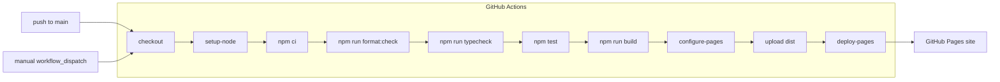

# Deploy

The site is static (`dist/` from `npm run build`), hosted on GitHub Pages and deployed by GitHub Actions. Sourced facts were fetched 2026-10-13 unless a later read date is given. Each carries its source and a status as in [data.md](data.md). The workflow is written in phase 0 ([phases.md](phases.md)).

## Flow

## Vite base

Source: https://vite.dev/guide/static-deploy#github-pages. A project page is served under the repository name, and `base` is that name between slashes. VERIFIED.

The repository is `solar-system`, deployed as a project page:

| Item | Value |
|---|---|
| URL | `https://<github-user>.github.io/solar-system/` |
| Vite `base` | `'/solar-system/'` |
| Visibility | public: GitHub Free requires it ([Plans and visibility](#plans-and-visibility)). The owning account uses GitHub Free (stated by the user) |

The Vite `base` must equal the repository name exactly, between slashes.

## Workflow

| Item | Value | Source | Status |
|---|---|---|---|
| Pages source | Settings > Pages > Source = GitHub Actions | https://vite.dev/guide/static-deploy#github-pages | VERIFIED |
| Workflow file | `.github/workflows/deploy.yml` | https://vite.dev/guide/static-deploy#github-pages | VERIFIED |
| Trigger | push to `main`, plus manual dispatch (`workflow_dispatch`) | https://vite.dev/guide/static-deploy#github-pages | VERIFIED |
| Permissions | `contents: read`, `pages: write`, `id-token: write` | https://vite.dev/guide/static-deploy#github-pages, https://docs.github.com/en/pages/getting-started-with-github-pages/using-custom-workflows-with-github-pages | VERIFIED |
| Concurrency | group `pages` | https://vite.dev/guide/static-deploy#github-pages | VERIFIED |
| Build output | static, `dist/` | https://vite.dev/guide/static-deploy#github-pages | VERIFIED |

## Action versions

| Action | Latest release | Vite sample | Status |
|---|---|---|---|
| [actions/configure-pages](https://github.com/actions/configure-pages/releases) | v6.0.0 | v6 | VERIFIED |
| [actions/upload-pages-artifact](https://github.com/actions/upload-pages-artifact/releases) | v5.0.0 | v5 | VERIFIED |
| [actions/deploy-pages](https://github.com/actions/deploy-pages/releases) | v5.0.1 | v5 | VERIFIED |
| [actions/checkout](https://github.com/actions/checkout/releases) | v7.0.1 | v7 | VERIFIED |
| [actions/setup-node](https://github.com/actions/setup-node/releases) | v7.1.0 | v7 | VERIFIED |

The workflow uses configure-pages v6, upload-pages-artifact v5 and deploy-pages v5, the majors of the Vite sample and the latest releases (default).

## Node in CI

CI runs the Node version in `.nvmrc` ([Layout and tooling](architecture.md#layout-and-tooling)). The combined Node range of the tooling is under Tooling in [data.md](data.md#tooling).

## Limits

Source: https://docs.github.com/en/pages/getting-started-with-github-pages/github-pages-limits.

| Limit | Value | Status |
|---|---|---|
| Published site size | at most 1 GB | VERIFIED |
| Bandwidth | soft, 100 GB per month | VERIFIED |
| Deployment | times out after 10 minutes | VERIFIED |

## Plans and visibility

- GitHub Pages works for a public repository on GitHub Free: "GitHub Pages is available in public repositories with GitHub Free and GitHub Free for organizations, and in public and private repositories with GitHub Pro, GitHub Team, GitHub Enterprise Cloud, and GitHub Enterprise Server." https://docs.github.com/en/pages/getting-started-with-github-pages/creating-a-github-pages-site, read 2026-10-28. VERIFIED.
- On GitHub Free and GitHub Free for organizations the repository must be public: "If the account that owns the repository uses GitHub Free or GitHub Free for organizations, the repository must be public." https://docs.github.com/en/pages/getting-started-with-github-pages/creating-a-github-pages-site. VERIFIED.
- Consequence: on GitHub Free the repository is public, so it holds no secrets. DERIVED.

## Approval

Creating the GitHub repository `solar-system`, enabling Pages and the first push are outward-facing steps. Each needs the user's approval. The user creates the repository.

The workflow is written but not activated: the file exists in the repo. No remote is added to the local project and nothing is pushed until the user approves.
