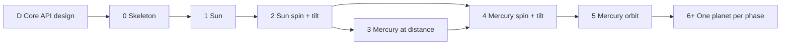

# Phases

The project is built phase by phase. A phase ends when its exit holds. Values and sources are in [data.md](data.md), structure in [architecture.md](architecture.md).

## Phase table

The gate is the four commands the CI workflow runs after `npm ci`: `npm run format:check`, `npm run typecheck`, `npm test` and `npm run build` ([Flow](deploy.md#flow)). Every 1e-9 tolerance in the exit lists is (default).

| # | Phase | Content | Exit |
|---|---|---|---|
| D | Core API design | Types `Vec3`, `Rate`, `KeplerElements`, `Orientation`, `Body` and `BodyState`; functions `stateAt`, `orientationAt`, `semiMajorAxisKm`, `jdFromDate` and `jdAtStep`; constants `JD_MIN`, `JD_MAX` and `OBLIQUITY_J2000_DEG`; the data file format, as recorded in [Core API](architecture.md#core-api). | Surface recorded in [architecture.md#core-api](architecture.md#core-api); no code yet, so the gate starts in phase 0 |
| 0 | Skeleton | Tooling, clock logic and date text, the handedness test, the CI workflow and the licence: [Phase 0 content](#phase-0-content) | Gate + [Phase 0 exit](#phase-0-exit) |
| 1 | Sun | The Sun in the core, the renderer and the UI, with the frame loop, camera controls and zoom: [Phase 1 content](#phase-1-content) | Gate + [Phase 1 exit](#phase-1-exit) |
| 2 | Sun spin + tilt | The surface spot and the axis line, and the Sun's tilt and spin: [Phase 2 content](#phase-2-content) | Gate + [Phase 2 exit](#phase-2-exit) |
| 3 | Mercury at distance | Mercury as a static sphere on +x, with its label and focus change: [Phase 3 content](#phase-3-content) | Gate + [Phase 3 exit](#phase-3-exit) |
| 4 | Mercury spin + tilt | Mercury's `poleEcliptic` and `primeMeridianDeg` come from `orientationAt` (defined for every body from phase 1); each frame, the renderer applies Mercury's tilt and spin from them, as for the Sun in phase 2. The renderer places Mercury with `semiMajorAxisKm` as in phase 3 ([One tick](architecture.md#one-tick)). Mercury's surface spot and axis line come from `createBodyNode` (phase 2). | Gate + [Phase 4 exit](#phase-4-exit) |
| 5 | Mercury orbit | The Kepler solver in the core, Mercury's position from `stateAt`, Horizons golden positions: [Phase 5 content](#phase-5-content) | Gate + [Phase 5 exit](#phase-5-exit) |
| 6+ | One planet per phase | Each planet has its own data file. Same checks as phase 5. Each planet is built with `createBodyNode`, surface spot and axis line included. | Gate + unit tests + visual check as in [phase 5](#phase-5-exit), for that planet's spin and orbit, with the JPL stated accuracy for that planet |

### Phase 0 content

- Node, the version in `.nvmrc` ([Layout and tooling](architecture.md#layout-and-tooling)); it is an external dependency that needs the user's approval.
- Vite, TypeScript, Three.js, Vitest and Prettier, with the npm scripts, config files and entry files under [Layout and tooling](architecture.md#layout-and-tooling), `.prettierignore` included; `index.html` is a minimal page.
- Clock logic and date text only, with no HTML controls ([Time](architecture.md#time)):
  - fixed 1 h step
  - conversion from `Date` to Julian date, rounded to a whole hour
  - the bounds
  - play/pause
  - speed with a sign, negative for reverse
  - the clock's initial speed, `INITIAL_SPEED_STEPS_PER_S` in `src/config`
  - jump to date
  - parsing and formatting of the date text
- Files, each with its test beside it ([Layout and tooling](architecture.md#layout-and-tooling)), without timers or DOM ([Clock API](architecture.md#clock-api)):
  - `src/core/time.ts` holds `jdFromDate`, `jdAtStep`, `JD_MIN` and `JD_MAX`
  - `src/app/clock.ts` holds `createClock`
  - `src/app/dateText.ts` holds `parseDateText` and `formatDateText`
  - `src/config/index.ts` holds `INITIAL_SPEED_STEPS_PER_S`
- Run `npm run typecheck` with typescript 7.0.2, @types/three 0.186.0 and three 0.186.1. If it fails in the declarations of @types/three, try in this order and keep the first that passes: `skipLibCheck` true under TypeScript 7, then the latest TypeScript 6.x with `skipLibCheck` false, then with true. Record the choice under [Tooling](data.md#tooling). If every step fails, or the failure is in the declarations of any other package, stop (see [Stop conditions](#stop-conditions)).
- Handedness test of the axis mapping under Three.js `Vector3.cross`, in `src/render/handedness.test.ts`, which defines the mapping locally as the renderer does not exist yet ([Phase 0 exit](#phase-0-exit)).
- GitHub Actions workflow that runs the gate and deploys the built minimal page ([deploy.md](deploy.md)).
- The `Status` line in `README.md` says phase 0 is done, as the code now exists.
- LICENSE file with the standard MIT licence text and the copyright line `Copyright (c) 2026 Linda Gustafsson`; `license` field `MIT` in package.json.

### Phase 0 exit

Unit tests, then the workflow check. In the unit tests, expected values are fixed numbers in the tests, not the code's own formula. The clock tests use the calls under [Clock API](architecture.md#clock-api); "at speed s" means `createClock(2451545.0, s)` followed by `play()`.

1. `JD_MIN` = 2378496.5 and `JD_MAX` = 2470172.4583333333 (59284139/24), each within 1e-9 d.
2. `jdAtStep(2451545.0, 1) - jdAtStep(2451545.0, 0)` = 1/24 d within 1e-9 d.
3. `jump` rounds by the rounding rule under [Time](architecture.md#time): at speed 1, `jump(jdFromDate(date))` for `new Date(Date.UTC(2026, 9, 27, 14, 29))` gives `jd` 2461341.0833333333 (14:00), and for `new Date(Date.UTC(2026, 9, 27, 14, 30))` 2461341.125 (15:00), each within 1e-9 d.
4. `INITIAL_SPEED_STEPS_PER_S` is 24, asserted in `src/config/index.test.ts`. `createClock(2451545.0, INITIAL_SPEED_STEPS_PER_S)` has `state` `'Paused'`; after `play()`, `update(0.5)` returns exactly 12 and `n` is 12.
5. A negative speed counts n down, and whole steps are truncated toward zero: at speed 1, three calls of `update(0.4)` return 0, 0 and 1, with `remainder` 0.2 within 1e-9 after; at speed -1 they return 0, 0 and -1.
6. `update` never returns -0: at speed -1, `update(0.4)` returns `steps` with `Object.is(steps, 0)` true.
7. Bound at `JD_MAX`: `createClock(2470172.375, 24)` (`JD_MAX` - 2/24), `play()`, then `update(1)` returns 2, `n` is 2 (n_max), `state` is `'Paused'` and `remainder` is 0.
8. Bound at `JD_MIN`, mirrored: `createClock(2378496.5833333333, -24)` (`JD_MIN` + 2/24), `play()`, then `update(1)` returns -2, `n` is -2 (n_min), `state` is `'Paused'` and `remainder` is 0.
9. The bound is a step index, not a Julian date: `createClock(2470172.4166666665, 24)` (59284138/24, `JD_MAX` - 1/24), `play()`, then `update(1)` returns 1, `n` is 1 (n_max), `state` is `'Paused'` and `jd` equals exactly 2470172.458333333, the double one ulp below `JD_MAX`, as `jdAtStep` gives start + n/24. A further `play()` leaves `state` `'Paused'`.
10. At a bound the fraction is dropped: `createClock(2470172.375, 20)`, `play()`, `update(0.125)` (2.5 steps, the whole steps reach n_max) and `createClock(2470172.375, 24)`, `play()`, `update(0.1875)` (4.5 steps, past n_max) each return 2 and leave `n` 2, `state` `'Paused'` and `remainder` 0. Reaching n_max exactly pauses too: `createClock(2470172.4166666665, 1)`, `play()`, `update(1)` returns 1, `n` is 1, `state` is `'Paused'` and `remainder` is 0. Play at a bound runs back into the range: `createClock(2470172.4583333333, -1)` (`JD_MAX`), `play()`, `update(0.5)` returns 0 and `state` stays `'Playing'`, then `update(0.5)` returns -1 and `n` is -1. Mirrored: `createClock(2378496.5, 1)` (`JD_MIN`), `play()`, `update(0.5)` returns 0 with `state` `'Playing'`, then `update(0.5)` returns 1. A clock already at a bound with the speed pointing out pauses: `createClock(2470172.4583333333, 1)` (`JD_MAX`), `play()`, `update(1)` returns 0, `n` is 0, `state` is `'Paused'` and `remainder` is 0; mirrored, `createClock(2378496.5, -1)` (`JD_MIN`), `play()`, `update(1)` gives the same.
11. `jump` sets the start Julian date and n = 0 and keeps the state: at speed 1, after `update(2)`, `jump(2461341.0833333333)` gives `jd` 2461341.0833333333 within 1e-9 d, `n` 0 and `state` `'Playing'`; on `createClock(2451545.0, 1)` without `play()`, the same jump keeps `state` `'Paused'`.
12. `createClock` rounds and clamps its start as `jump` does: `createClock(JD_MIN - 1, 24)` has `jd` 2378496.5 (`JD_MIN`) and `n` 0; `createClock(2461341.0833333333 + 0.01, 24)` (14:14:24 UTC) has `jd` 2461341.0833333333 (14:00) and `createClock(2461341.0833333333 + 0.03, 24)` (14:43:12 UTC) has `jd` 2461341.125 (15:00); each `jd` within 1e-9 d.
13. `jump` clamps to the bounds and keeps the state: at speed 1, `jump(JD_MAX + 5)` gives `jd` 2470172.4583333333 (`JD_MAX`), `n` 0 and `state` `'Playing'`, and `jump(JD_MIN - 5)` gives `jd` 2378496.5 (`JD_MIN`), `n` 0 and `state` `'Playing'`; each `jd` within 1e-9 d.
14. `pause` resets the remainder: at speed 1, `update(0.6)` returns 0; after `pause()` and `play()`, `update(0.6)` returns 0.
15. `jump` resets the remainder: at speed 1, `update(0.6)` returns 0; after `jump(2451545.0)`, `update(0.6)` returns 0.
16. `setSpeed` resets the remainder: at speed 1, `update(0.6)` returns 0; after `setSpeed(-1)`, `update(1.2)` returns -1. At speed 1, `update(0.6)` returns 0; after `setSpeed(2)`, `update(0.4)` returns 0, with `remainder` 0.8 within 1e-9 after.
17. `play()` on `createClock(2451545.0, 0)` leaves `state` `'Paused'`, and at speed 1, after `setSpeed(0)`, `update(2.5)` returns 0. Invalid input changes nothing: at speed 1, after `update(0.5)`, `update(NaN)`, `update(Infinity)` and `update(-1)` each return 0 and leave `n`, `jd`, `state` and `remainder` (0.5) as they were; `setSpeed(NaN)`, `setSpeed(Infinity)`, `jump(NaN)` and `jump(Infinity)` leave `speedStepsPerSecond`, `jd`, `n` and `remainder` (0.5) as they were; `createClock(NaN, 1)` and `createClock(2451545.0, NaN)` throw a `RangeError`.
18. `parseDateText('2026-10-27 14:00')` returns 2461341.0833333333 (2461341 + 1/12) within 1e-9 d, and `formatDateText` of that Julian date returns exactly `'2026-10-27 14:00'`, the display text without `UTC`.
19. `formatDateText(2440587.5416666665)` returns `'1970-01-01 01:00'`.
20. `parseDateText` returns `null` for `'2026-10-27 14:00 UTC'`, `'2026-13-40 99:99'`, `'2026-02-30 00:00'`, `'2027-02-29 00:00'` and `''`, and a number for `'2028-02-29 00:00'`.
21. Handedness, a check that (x, z, -y) is a proper rotation under Three.js `Vector3.cross`: with map(x, y, z) = (x, z, -y), map(1, 0, 0) x map(0, 1, 0), computed with `Vector3.cross`, equals map(0, 0, 1), and map(0, 0, 1) = (0, 1, 0), each component compared with `===`, so -0 equals 0.
22. File check: `.github/workflows/deploy.yml` lists push to `main` and `workflow_dispatch` under `on:`, and `grep -nE 'npm (ci|run format:check|run typecheck|test|run build)' .github/workflows/deploy.yml` prints `npm ci`, `npm run format:check`, `npm run typecheck`, `npm test` and `npm run build`, in that order ([Flow](deploy.md#flow)).

### Phase 1 content

- In `src/core`: types `Vec3`, `Rate`, `KeplerElements`, `Orientation`, `Body` and `BodyState`, and the constant `OBLIQUITY_J2000_DEG`.
- `orientationAt` for every body: `poleEcliptic` from the pole RA/Dec and `OBLIQUITY_J2000_DEG`, `primeMeridianDeg` from W.
- `stateAt` for the Sun (`orbit` null): position at the origin, `poleEcliptic` and `primeMeridianDeg` from `orientationAt`. Its behaviour for a body with an `orbit` is under [Core API](architecture.md#core-api).
- Sun data in `data/sun.ts` ([Core API](architecture.md#core-api)). Expected pole values in [data.md](data.md#sun).
- Frame loop in `src/app`, camera follow included ([View](architecture.md#view)).
- HTML controls in `src/ui` for the phase 0 clock: play/pause, the speed, the date display, the jump-to-date field with its jump button, and the range display ([Time](architecture.md#time)).
- Sun sphere, built with `createBodyNode` in `src/render` ([Scene graph per body](architecture.md#scene-graph-per-body)); the surface spot and the axis line are not part of phase 1.
- Colours `BACKGROUND_COLOR` and `BODY_COLORS` with the Sun's entry ([Layout and tooling](architecture.md#layout-and-tooling)).
- Sun label, set up as in [View](architecture.md#view). The Sun is the only body and the focus, so activating its label has no effect.
- Controls, the canvas (`role="img"`, `aria-label`) and the Sun label as accessible elements, as in [Accessibility](architecture.md#accessibility).
- Scale (`DISTANCE_KM_PER_UNIT`, true scale only), logarithmic zoom with limits, focus with the camera orbiting the focused body, initial focus the Sun, initial body fill 0.8 of the window height (default), initial camera direction `INITIAL_CAMERA_DIRECTION`, camera field of view 45 deg (default): all as config constants in `src/config` ([Scale](architecture.md#scale), [View](architecture.md#view)).
- Start zoom from the window height when the page loads, by the initial zoom rule in [View](architecture.md#view): at start the Sun disc fills 80% of the window height (800 px of 1000 px).
- The window resize handler updates the canvas size and the camera aspect and keeps the camera distance ([View](architecture.md#view)).
- Camera controls: Three.js `OrbitControls`, set up as in [View](architecture.md#view).
- The depth-buffer decision under [Scale](architecture.md#scale).

### Phase 1 exit

1. Unit test: `poleEcliptic` from `orientationAt` for the Sun, converted to ecliptic longitude and latitude with the test helper `toLonLatDeg`, each within ±0.005 deg of the Sun pole values in [data.md](data.md#sun).
2. Unit test: tilt, the angle between that `poleEcliptic` and the ecliptic pole (0, 0, 1), 7.25 ±0.01 deg.
3. Unit test `OBLIQUITY_J2000_DEG is 23.43928 deg, the JPL J2000 obliquity`: `OBLIQUITY_J2000_DEG` from the core equals the fixed number 23.43928, exactly ([data.md](data.md#mercury-orientation)).
4. Unit test: `primeMeridianDeg` from `orientationAt` for the Sun is 84.176 at JD 2451545.0 and 98.3604 at JD 2451546.0, each within 1e-9 deg.
5. Unit test: `primeMeridianDeg` from `orientationAt` for the Sun is reduced to [0, 360): 62.616 at JD 2451645.0 (unreduced 1502.616) and 105.736 at JD 2451445.0 (unreduced -1334.264), each within 1e-9 deg.
6. Unit test: `stateAt` for the Sun gives the same `poleEcliptic` and `primeMeridianDeg` as `orientationAt` at the same `jdTdb`, exactly equal.
7. Unit test: `stateAt` for a `Body` with a non-null `orbit` throws an `Error`.
8. Unit test: start zoom for the Sun in a 1000 px high window by the initial zoom rule in [View](architecture.md#view), 1832.25 ±0.01 km per pixel.
9. Unit test: `OrbitControls` target change: camera (0, 0, 10), target (0, 0, 0), `update()`; set target (5, 0, 0), `update()`: camera stays (0, 0, 10); then move camera and target by (5, 0, 0), `update()`: camera (5, 0, 10); each expected camera position within 1e-9 per coordinate, since the floating-point result is not exact.
10. Unit test: the app's camera follow, with `OrbitControls` constructed without a `domElement` ([Tooling](data.md#tooling)). Camera (0, 0, 10), target (0, 0, 0) and the focused body at (0, 0, 0); the body moves to (5, 0, 0) and one frame of the app's follow runs: target (5, 0, 0) and camera (5, 0, 10), each within 1e-9 per coordinate. Without the app's camera move, `update()` leaves the camera at (0, 0, 10), so the test fails.
11. Unit test: the start camera position, with the Sun focused at the origin, is the start distance d of the initial zoom rule along `INITIAL_CAMERA_DIRECTION` ([View](architecture.md#view)): (0, 0.635534844935, 2.118449483117) scene units within 1e-9 per coordinate (DERIVED). A top-down start, (0, 2.211726192738, 0), differs by more than 1 in two coordinates, so the test fails (DERIVED).
12. Visual check: at start the Sun disc, in `BODY_COLORS.sun` ([Layout and tooling](architecture.md#layout-and-tooling)), is centred, fills 80% of the window height (800 px of 1000 px, within 1 px) and its edge is visible.
13. Visual check: resizing the window height by half halves the Sun's pixel height.
14. Visual check: wheel zoom out reaches the overview zoom, where the Sun radius is about 5 px (DERIVED).
15. Visual check: wheel steps are equal in percentage.
16. Visual check: the label 'Sun' stays next to the Sun when zooming and rotating.
17. Visual check: Tab reaches each control and the 'Sun' button.
18. Visual check: Play starts the date display advancing, about 1 simulated day per real second at the initial speed.
19. Visual check: speed 48 makes the date display advance about 2 simulated days per real second.
20. Visual check: with the clock Paused, `2026-10-27 14:00` in the jump-to-date field and the jump button set the date display to `2026-10-27 14:00`.
21. Visual check: `2026-13-40 99:99` in the jump-to-date field and the jump button show the rejection message and leave the date display unchanged.
22. Visual check: the range text `1800-01-01 00:00` to `2050-12-31 23:00` with the label `UTC` is visible next to the jump-to-date field.
23. The depth-buffer decision is written into [Scale](architecture.md#scale).

### Phase 2 content

- `createBodyNode` gains the surface spot in `SPOT_COLOR` and the axis line in `AXIS_COLOR` ([Layout and tooling](architecture.md#layout-and-tooling)), so every body built with it carries both ([Scene graph per body](architecture.md#scene-graph-per-body)).
- Each frame, the renderer applies the Sun's tilt from `poleEcliptic` and its spin from `primeMeridianDeg`, both from `stateAt` (equal to `orientationAt`).
- The tilt group's local +X lies along the node Q, which the renderer computes from `poleEcliptic` and `OBLIQUITY_J2000_DEG` ([Frame](architecture.md#frame)).

### Phase 2 exit

1. Unit test: after the renderer applies the Sun's tilt to the Sun's node from `createBodyNode`, the tilt group's +Y axis in world coordinates is (0.122353493472, 0.992001139769, 0.031038062619) within 1e-9 per coordinate. That vector is the Sun's `poleEcliptic` from the pole in [data.md](data.md#sun), mapped to Three.js axes (DERIVED).
2. Unit test: the node Q the renderer computes from the Sun's `poleEcliptic` (from `orientationAt`) has length 1 and is perpendicular to `poleEcliptic`, each within 1e-9, and is (0.960633820850, 0.254892757571, -0.110509476414) in the ecliptic frame within 1e-9 per coordinate. After the renderer applies the Sun's tilt, the tilt group's +X axis in world coordinates is Q mapped to Three.js axes, (0.960633820850, -0.110509476414, -0.254892757571), within 1e-9 per coordinate. Both vectors are DERIVED ([Frame](architecture.md#frame)).
3. Unit test: after the renderer applies the Sun's tilt and spin from `orientationAt` at JD 2451545.0 (W = 84.176 deg) to the Sun's node from `createBodyNode`, the unit vector from the node's world position to the spot marker's world position is (-0.150658034646, 0.049474620477, -0.987347162109) within 1e-9 per coordinate: Q turned about the pole by +84.176 deg, counter-clockwise seen from the north pole, mapped to Three.js axes (DERIVED). With W applied in the mirrored sense, or with Q at the pole's RA - 90 deg, a coordinate differs by more than 0.9, so the test fails (DERIVED).
4. Visual check: at start, the axis line, in `AXIS_COLOR` ([Layout and tooling](architecture.md#layout-and-tooling)), leans visibly from the screen vertical, which is the ecliptic normal in the start view ([View](architecture.md#view)); test 1 above and [Phase 1 exit](#phase-1-exit) test 2 pin the angle.
5. Visual check: at the initial speed, 1 simulated day per real second, the spot, in `SPOT_COLOR`, completes one turn in 25.4 ±1 s.

### Phase 3 content

- Mercury as a static sphere on +x of the ecliptic at its scaled semi-major axis a ([One tick](architecture.md#one-tick)).
- Mercury is built with `createBodyNode`, as the Sun, so from phase 2 it carries the surface spot and the axis line; they stay untilted and unspinning until phase 4.
- Its colour is `BODY_COLORS.mercury` ([Layout and tooling](architecture.md#layout-and-tooling)).
- `semiMajorAxisKm(orbit)` in the core gives a in km ([Core API](architecture.md#core-api)). The renderer divides it by `DISTANCE_KM_PER_UNIT` through the scale function: scene units = km / `DISTANCE_KM_PER_UNIT`.
- The frame loop in `src/app` calls `semiMajorAxisKm` with `body.orbit` after a null check, here `semiMajorAxisKm(mercury.orbit)`: `data/mercury.ts` always has an orbit.
- Mercury label, as in phase 1.
- Focus change by activating a label, 'Sun' or 'Mercury' ([View](architecture.md#view)).

### Phase 3 exit

1. Unit test of the scale function: Mercury's a = 57,909,226.54 km gives 57.90922654 scene units at `DISTANCE_KM_PER_UNIT` = 1,000,000, relative error <= 1e-12 against that number, pure double arithmetic.
2. Unit test: `mercury.orbit` is not null, then `semiMajorAxisKm(mercury.orbit)` is 57,909,227 km within 0.5 km (figure in whole km from [data.md](data.md#mercury-orbit)).
3. Visual check: click 'Mercury': Mercury, in `BODY_COLORS.mercury` ([Layout and tooling](architecture.md#layout-and-tooling)), moves to the screen centre and the zoom stays; click 'Sun': back to the Sun.
4. Visual check: Tab then Enter on 'Mercury' moves the focus to Mercury.

### Phase 4 exit

1. Unit test: at J2000 (T = 0), Mercury's pole (`poleEcliptic` from `orientationAt`) is 0.034 ±0.005 deg from the orbit normal (derived value 0.0340). The orbit normal comes from Table 1 values at T = 0: ecliptic lon 318.33, lat 82.995.
2. Unit test: Mercury's `primeMeridianDeg` from `orientationAt` at JD 2451545.0 is 329.5988 within 1e-9 deg.
3. Unit test: the node Q the renderer computes from Mercury's `poleEcliptic` (from `orientationAt` at JD 2451545.0) has length 1 and is perpendicular to `poleEcliptic`, each within 1e-9, and is (0.981592866061, 0.175225746879, -0.075969618464) in the ecliptic frame within 1e-9 per coordinate. After the renderer applies Mercury's tilt, the tilt group's +X axis in world coordinates is Q mapped to Three.js axes, (0.981592866061, -0.075969618464, -0.175225746879), within 1e-9 per coordinate. Both vectors are DERIVED ([Frame](architecture.md#frame)).
4. Unit test: after the renderer applies Mercury's tilt and spin from `orientationAt` at JD 2451545.0 (W = 329.5988 deg) to Mercury's node from `createBodyNode`, the unit vector from the node's world position to the spot marker's world position is (0.931495146947, -0.114160601556, 0.345375372988) within 1e-9 per coordinate: Q turned about the pole by +329.5988 deg, counter-clockwise seen from the north pole, mapped to Three.js axes (DERIVED). With W applied in the mirrored sense, or with Q at the pole's RA - 90 deg, a coordinate differs by more than 0.9, so the test fails (DERIVED).
5. Unit test: Mercury's `primeMeridianDeg` from `orientationAt` at JD 2451645.0 is 223.44988 (unreduced 943.44988) within 1e-9 deg.
6. Unit test: Mercury's `poleEcliptic` from `orientationAt` at JD 2469807.5 (T = 0.5) is (0.091250546029, -0.081666077632, 0.992473672000) within 1e-9 per coordinate (DERIVED).
7. Visual check: at the initial speed, 1 simulated day per real second, the spot completes one turn in 58.6 ±1 s.

### Phase 5 content

- Kepler solver per JPL steps, in the core.
- For bodies with an `orbit`, `stateAt` gives the position through it, and the renderer takes the position from `stateAt` instead of the static placement of phase 3.
- Table 1 holds only inside the bounds; the clock (App) keeps the sim time inside them ([Time](architecture.md#time)).
- Golden positions for Mercury come from JPL Horizons at five dates inside the bounds: 1800-01-01 00:00, 1900-01-01 00:00, 2000-01-01 12:00 (J2000), 2025-01-01 00:00 and 2050-12-31 23:00.
- Horizons settings: vectors, geometric (positions without light-time correction), centre the Sun, reference frame mean ecliptic and equinox of J2000, time scale TDB, output in km.
- The fetch is an external call that needs the user's approval and is made in this phase.
- The golden values are fixed numbers in the test file; tests never use the network.

### Phase 5 exit

1. Unit test against a second, independent implementation in the test file, written straight from the JPL steps: |Δr| / |r| <= 1e-9, with Δr the difference between the two position vectors and r the position vector of the independent implementation.
2. Unit test against the Horizons golden values at the five dates, within the JPL stated accuracy for Mercury ([Mercury orbit](data.md#mercury-orbit)).
3. [Phase 1 exit](#phase-1-exit) test 7 is deleted from the suite: `stateAt` computes the position for a body with an `orbit`.
4. Visual check: at the initial speed, 1 simulated day per real second, Mercury completes two orbits in 175.9 ±2 s, and in that time the spot completes three turns, ±1/4 turn: the 3:2 resonance.

## Invariants

The [invariants](architecture.md#invariants) hold in every phase. Per phase, in addition:

| # | Invariant |
|---|---|
| 0 | The clock advances in fixed 1 h steps; the same start Julian date and step counter give the same sim time. |
| 0 | The clock (App) keeps the sim time within `JD_MIN`..`JD_MAX` from the core by the bound rules under [Time](architecture.md#time). |
| 1 | The UI shows the range. |
| 1 | Sun radius is 695,700 km in core and is scaled only in the renderer. |
| 1 | Scale, zoom and focus constants live only in `src/config`. |
| 2 | Axis line and surface spot markers live only in the renderer. |
| 3 | Mercury's scaled distance comes from one scale function, scene units = km / `DISTANCE_KM_PER_UNIT`. |

## Stop conditions

Stop and return to the user if:

- The typecheck fails in the declarations of @types/three after every fallback step, or in the declarations of any other package.
- Node cannot be installed.
- Phase 5 reaches the Horizons fetch without the user's approval.
- A golden position deviates more than the JPL stated accuracy, for Mercury under [Mercury orbit](data.md#mercury-orbit).

## Verification

- Every phase exit from phase 0 runs the gate. Green is each runner's own printed summary.
- Visual checks are made by eye in the tested browsers, see [Constraints](architecture.md#goals-and-constraints).
- Every visual check includes the frame rate target in [Constraints](architecture.md#goals-and-constraints).
- Golden positions come from JPL Horizons (https://ssd.jpl.nasa.gov/api/horizons.api), as under [Phase 5 content](#phase-5-content).

## Risks and unknowns

- The typecheck of @types/three, status under [Tooling](data.md#tooling).
- Three.js handedness has no official sentence. The official docs say Y up and the camera looks along -Z. Right-handedness is derived from the r186 source ([data.md](data.md#tooling)); the phase 0 handedness test checks it for `Vector3.cross` only.
- Mercury's W sine terms are omitted ([Constraints](architecture.md#goals-and-constraints)).
- Sun differential rotation is not modelled.
- NSSDC values disagree with JPL Table 1 and IAU 2015 in places (see the contradictions in [data.md](data.md#contradictions)).
- float32 depth precision on the GPU over the scene's depth range ([Scale](architecture.md#scale)).
- A zoom that puts the camera inside the focused body is not allowed. The zoom-in limit is in [Scale](architecture.md#scale).
- The node Q formula needs |Dec| < 90 deg ([Frame](architecture.md#frame)). Earth's pole Dec is 90 deg at J2000 (NAIF pck00011.tpc `BODY399_POLE_DEC` = 90 - 0.557 T), so the Earth phase needs its own rule for Q before it starts.

## Deferred

- N-body
- Moons
- Rings
- Lighting
- Textures
- Orbit lines
- Swedish UI text
- The game engine
- Speed cap against spin aliasing
- ESLint

## Dependencies

